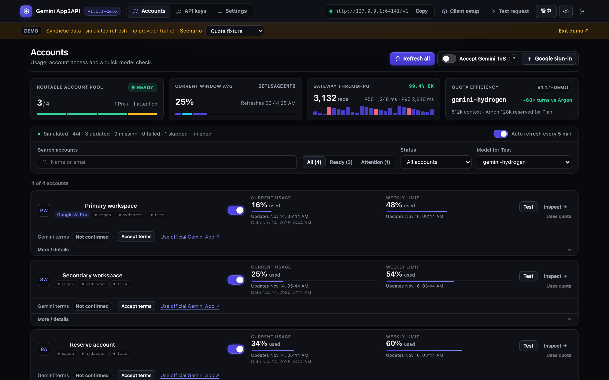
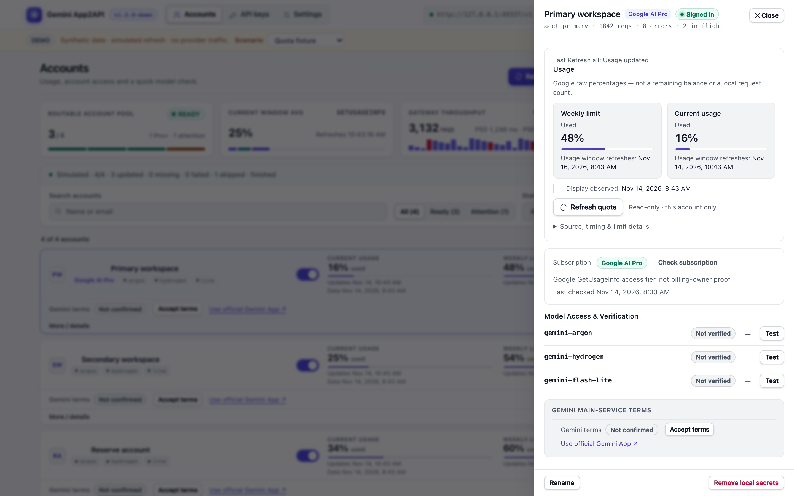
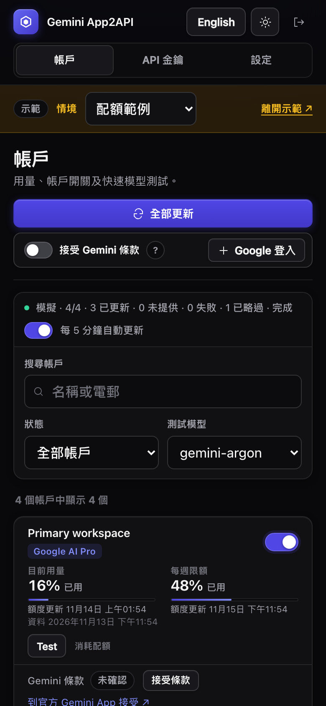

<div align="center">

# Gemini App2API

**Your coding agents. Your Gemini subscriptions. One zero-dependency native HTTP/2 gateway.**

Connect your own eligible Gemini accounts to OpenAI-compatible IDEs, CLI agents, and SDKs through a self-hosted Node.js gateway—featuring incremental SSE, caller-owned tool validation, multi-account failover, and a bilingual operations console.

[](https://github.com/ShawTim/gemini-app2api/actions/workflows/ci.yml)


[](LICENSE)

**English** · [繁體中文](README.zh.md) · [Quick Start](#quick-start) · [Connect Your Client](#connect-your-client) · [API Reference](docs/API_SUPPORT.md) · [Operations](docs/OPERATIONS.md)

</div>

> [!IMPORTANT]
> **Unofficial interoperability research project.** Not affiliated with, endorsed by, or sponsored by Google. Using third-party clients or gateways may violate Google's Terms of Service—your accounts, your responsibility. You must supply your own eligible Google accounts and a compatible OAuth client profile; no credentials, tokens, or Google binaries are distributed. Read the full [Disclaimer](DISCLAIMER.md).



---

## Why Gemini App2API?

<p align="center">
  
  <br />
  <sub><strong>🧢 MGGA — Make Gemini Great Again:</strong> A frontier GigaChad model trapped inside a consumer chat harness.</sub>
</p>

Ever noticed how Gemini can feel constrained inside the consumer Gemini App—losing thread context or struggling to drive multi-step local engineering workflows? **The bottleneck is rarely the base model; it is the consumer chat harness wrapped around it.**

- **Free the model into real engineering harnesses:** Connect **Cursor, Cline, Roo Code, OpenAI Codex CLI, PI-Desktop, Cherry Studio, or Open WebUI** via standard `/v1/chat/completions` and `/v1/responses` endpoints while keeping full conversation history and local tool execution under your client's control.
- **Native HTTP/2 protocol—not brittle web scraping:** Communicates directly with Gemini's Robin HTTP/2 service using pure Node.js built-ins (`node:http2`, `node:crypto`), without headless browsers, cookie scraping, or patching local desktop binaries.
- **Multi-account pooling for rolling usage windows:** Intensive agentic coding can hit a single account's 5-hour or weekly window quickly. Pool multiple accounts you legitimately own with soft session affinity, read-only official usage bars, and configurable quota failover.
- **Built to protect agent loops:** Prevents coding agents from discarding 3,000+ bytes of streamed code or infinitely re-sending full conversation histories when upstream streams reset mid-turn (see [Completion Contract](docs/COMPLETION_CONTRACT.md)).
- **Honest upstream boundaries:** Decoupling the local client harness does **not** bypass Google's servers—all upstream context limits, rate limits, safety filters, and account entitlements remain enforced by Google.

### How It Compares

| Dimension | **Gemini App2API** | Web / Cookie Scrapers | Desktop App Injection / MITM |
|---|---|---|---|
| **Transport** | Direct native HTTP/2 (`ProcessQuery`) + resumable image upload | Fragile web DOM or reverse-engineered browser cookies | Binary hooks or local traffic interception |
| **Auth lifecycle** | Standard Google OAuth + refresh tokens in `0600` local state | Frequent cookie expiration & CAPTCHA friction | Coupled to a single running desktop GUI session |
| **Tool calling** | Schema-validated prompt protocol + Responses `namespace` support | Unvalidated text regex or unsupported | Limited to built-in consumer UI capabilities |
| **Multi-account** | Pooled routing, soft session affinity, batch usage & tier telemetry | Manual cookie swapping | Single active desktop user |
| **Runtime footprint** | Pure Node.js `>= 22`, **0 production npm dependencies** | Playwright / Puppeteer / heavy Python stacks | OS-specific app bundle & binary version lock |

---

## Key Features

- **Scoped OpenAI Compatibility (`Chat` & `Responses`):** Supports `GET /v1/models`, `POST /v1/chat/completions`, and `POST /v1/responses` with JSON or incremental SSE streaming, `reasoning_effort` / `reasoning.effort` mapping, and static PNG/JPEG/WebP image input.
- **Caller-Owned Function Tools:** Clients declare JSON Schema functions (including Responses `type: "namespace"` groups), execute approved calls locally, and replay results. The gateway validates every tool name and argument schema before emission—never executing shell commands or touching your workspace.
- **Zero-Dependency, Security-First Runtime:** Zero third-party production npm packages. Enforces `0700`/`0600` private state permissions, `scrypt` admin password hashing, SHA-256 hashed client API keys, strict `Origin`/`Host`/`X-CSRF-Token` admin protections, and SSRF-guarded opt-in remote image fetching.
- **Bilingual Operations Console (`English` / `繁體中文`):** Manage accounts, inspect rolling **Current usage** and **Weekly limit** bars via read-only `GetUsageInfo` batches, explicitly review or accept Gemini Terms of Service, issue client API keys, and inspect sanitized HTTP/gRPC diagnostics across desktop and mobile.

| Light Theme — Overview & Latency Telemetry | Mobile Console — Traditional Chinese (`繁體中文`) |
|---|---|
|  |  |

---

<a id="quick-start"></a>
## Quick Start

### 1. Prerequisites

- **Node.js 22+** (`>= 22.0.0`), npm, a modern browser, and a Google account with Gemini access (macOS or Linux).
- A **compatible static OAuth client profile** supplied from an authorized private source (not distributed in this repo; a Google AI Studio API key is a different service and cannot be substituted). Review the [OAuth profile format and setup guide](docs/OPERATIONS.md#private-initial-setup--私密初始化) first.

### 2. Initialize and Start

From the repository root:

```sh
npm ci --omit=dev --ignore-scripts
export GATEWAY_DATA_DIR="$HOME/.gemini-app2api"

# Create a private 0600 .env without overwriting an existing one:
test -e .env || cp .env.example .env
chmod 600 .env
# Edit .env and set GATEWAY_ADMIN_PASSWORD to a unique 12–256 character secret.

node bin/gemini-gateway init
node bin/gemini-gateway import-profile < /private/path/oauth-profile.json
node bin/gemini-gateway start
```

> **Prefer Docker?** Follow the hardened [Docker Compose deployment guide](docs/OPERATIONS.md#docker--linux-loopback-publishing--linux-docker-本機發佈) (runs as `uid 1000` with read-only rootfs, dropped capabilities, and loopback port publishing).

### 3. Sign In and Create a Client Key

Open **http://127.0.0.1:18989/admin/** in your browser:

1. Sign in with your `GATEWAY_ADMIN_PASSWORD` (if left empty, passwordless admin is restricted strictly to loopback—see [Remote access with TLS](docs/OPERATIONS.md#remote-access-with-tls--遠端-tls)).
2. Under **Accounts**, click **+ Google sign-in** and complete Google OAuth + MFA in your browser.
3. Click **Test** on the account card to verify live model access (note: **Test** sends one real request and uses quota; OAuth sign-in alone does not verify model entitlement).
4. Open **API keys → Create key** and copy your one-time client API secret.

---

<a id="connect-your-client"></a>
## Connect Your Client

Point any supported **OpenAI-compatible** client at your gateway:

| Setting | Value |
|---|---|
| **Base URL** | `http://127.0.0.1:18989/v1` (or your HTTPS reverse-proxy URL `/v1`) |
| **API Key** | Client key generated in **API keys** (never your admin password or Google token) |
| **Model** | `gemini-argon` (Pro reasoning/coding), `gemini-hydrogen` (Gemini 4 Hydrogen), or `gemini-flash-lite` |
| **Endpoints** | `/v1/chat/completions` or `/v1/responses` ([supported contract](docs/API_SUPPORT.md)) |

Verify model discovery (zero quota used):

```sh
curl -fsS http://127.0.0.1:18989/v1/models \
  -H "Authorization: Bearer $GEMINI_GATEWAY_KEY"
```

Send a Chat Completions request (add `"stream": true` with `curl -N` for incremental SSE):

```sh
curl -fsS http://127.0.0.1:18989/v1/chat/completions \
  -H "Authorization: Bearer $GEMINI_GATEWAY_KEY" \
  -H "Content-Type: application/json" \
  -d '{"model":"gemini-argon","messages":[{"role":"user","content":"Hello!"}]}'
```

### Client Setup Recipes

<details>
<summary><strong>Cursor</strong></summary>

1. Open **Cursor Settings → Models**.
2. Add custom model `gemini-argon` (and optionally `gemini-hydrogen`).
3. Enable **Override OpenAI Base URL**, set it to `http://127.0.0.1:18989/v1` (note: Cursor requires a publicly reachable HTTPS tunnel/reverse-proxy if its cloud relay mediates requests in your mode), and paste your gateway client API key.

</details>

<details>
<summary><strong>Cline / Roo Code (VS Code)</strong></summary>

1. Choose **API Provider:** `OpenAI Compatible`.
2. **Base URL:** `http://127.0.0.1:18989/v1`
3. **API Key:** Your gateway client key.
4. **Model ID:** `gemini-argon` (supports streaming, caller tool loops, and static image attachments).

</details>

<details>
<summary><strong>OpenAI Codex CLI (<code>~/.codex/config.toml</code>)</strong></summary>

Codex CLI speaks the `/v1/responses` protocol natively (including namespace tools and reasoning effort mapping):

```toml
model = "gemini-argon"
model_provider = "gemini_app2api"
model_reasoning_summary = "none"
web_search = "disabled"

[model_providers.gemini_app2api]
name = "Gemini App2API"
base_url = "http://127.0.0.1:18989/v1"
env_key = "GEMINI_GATEWAY_KEY"
wire_api = "responses"
```

</details>

<details>
<summary><strong>Cherry Studio / Open WebUI / OpenAI SDKs</strong></summary>

- **Cherry Studio / Open WebUI:** Add an OpenAI provider with API Host `http://127.0.0.1:18989/v1`, paste your gateway client key, and fetch `/v1/models` (`gemini-argon`, `gemini-hydrogen`, `gemini-flash-lite`).
- **Official JS & Python SDKs:** See runnable caller-tool loop examples in [`examples/client.mjs`](examples/client.mjs) and [`examples/client.py`](examples/client.py). Always replay complete conversation history (including `tool_call_id` / `call_id` pairs) on every turn.

</details>

---

## Models and Capabilities

| Model Alias | Role & Tier | Native Mode | Advertised Context Metadata |
|---|---|---:|---|
| **`gemini-argon`** | **Flagship Pro-tier mode** for complex coding, architecture, and multi-step agent loops | `8` | `context_window: 128000` (advisory client budget) |
| **`gemini-hydrogen`** | **Gemini 4 Hydrogen** for low-latency everyday reasoning and fast interactive tasks (upstream Hydrogen attribution verified) | `FAST` (`1`) | Not advertised |
| **`gemini-flash-lite`** | High-throughput lightweight tasks | `6` | Not advertised |

> Model aliases map to native Gemini App modes rather than pinned Google Cloud Vertex/AI Studio version strings, and model availability depends on each signed-in account's upstream entitlement. `context_window: 128000` is an advisory hint for client-side context management—not an enforced token cap or upstream guarantee.

| Capability | Supported Scope |
|---|---|
| **Endpoints** | `GET /v1/models`, `POST /v1/chat/completions`, `POST /v1/responses` |
| **Function Tools** | Bounded JSON Schema validation, `auto`/`none`/`required`/named `tool_choice`, and Responses function-only `namespace` groups; executed strictly by the caller |
| **Image Input** | Up to `4` static PNG/JPEG/WebP images (`<= 2 MiB` combined) via `data:` URLs or opt-in SSRF-guarded public HTTP(S) URLs |
| **Google Search** | Opt-in `"native_search": true` (`gemini-argon`, thinking `2`, text-only `<= 16 KiB`, no caller tools/images in the same turn) |
| **Thinking Control** | Synchronous `thinking_level` (`0`, `1`, `2`, `4`; default `2`) and OpenAI `reasoning_effort` (`none`/`minimal`→`0`, `low`→`1`, `medium`/`high`/`xhigh`→`2`); async Deep Think (`3`) rejected locally |
| **Usage Accounting** | Heuristic token estimates (`estimated: true`)—not official Google token counts or billing figures |

---

## Security and Operational Principles

- **Keep private state off Git and public networks:** Never share `.env`, OAuth client profiles, refresh tokens, client API keys, or `GATEWAY_DATA_DIR`. See [SECURITY.md](SECURITY.md).
- **Client-owned history & permissions:** The gateway never runs shell/file tools, never truncates or summarizes conversation history behind your back, and rejects silent upstream model downgrades.
- **Explicit incomplete-turn semantics:** Interrupted streams that already flushed usable output close cleanly with `incomplete: true` metadata so coding agents keep delivered work; always check `incomplete` when exact upstream completion matters. See [COMPLETION_CONTRACT.md](docs/COMPLETION_CONTRACT.md).
- **Deliberate recovery budgets:** Enabling `GATEWAY_QUOTA_FAILOVER=1` or `GATEWAY_AUTOMATIC_RECOVERY=1` helps survive single-account limits or transient resets, at the cost of additional upstream attempts when failures occur. See [OPERATIONS.md](docs/OPERATIONS.md#configuration--設定) and [LOCKS_AND_LIMITS.md](docs/LOCKS_AND_LIMITS.md).

---

## Documentation

| Document | Contents |
|---|---|
| [API Support & Contract (`docs/API_SUPPORT.md`)](docs/API_SUPPORT.md) | Endpoints, request/event schemas, tools, images, native search, and error codes |
| [Operations Guide (`docs/OPERATIONS.md`)](docs/OPERATIONS.md) | Setup, `.env` config, Docker Compose, reverse-proxy TLS, `launchd` supervision, and troubleshooting |
| [Account Lifecycle (`docs/ACCOUNT_LIFECYCLE.md`)](docs/ACCOUNT_LIFECYCLE.md) | Google OAuth sign-in, explicit Gemini ToS consent, subscription snapshots, and quota semantics |
| [Completion Contract (`docs/COMPLETION_CONTRACT.md`)](docs/COMPLETION_CONTRACT.md) | Partial-output preservation, `GENERATION_FAILED` zero-output handling, and caller dispositions |
| [Locks & Limits (`docs/LOCKS_AND_LIMITS.md`)](docs/LOCKS_AND_LIMITS.md) | Concurrency caps, wire/payload bounds, coalescing rules, and non-locking session design |
| [Verification & Testing (`docs/CURRENT_CONTRACT_TESTS.md`)](docs/CURRENT_CONTRACT_TESTS.md) | Offline synthetic test suites, [test safety boundaries](docs/TEST_EXECUTION_SAFETY.md), and [dev dependencies](docs/DEPENDENCIES.md) |
| [Security (`SECURITY.md`)](SECURITY.md) · [Contributing (`CONTRIBUTING.md`)](CONTRIBUTING.md) | Security model, vulnerability reporting, and contribution workflow |
| [Changelog (`CHANGELOG.md`)](CHANGELOG.md) · [Disclaimer (`DISCLAIMER.md`)](DISCLAIMER.md) | Release history and legal/account-risk notice |

---

<div align="center">

[MIT License](LICENSE) · [Disclaimer](DISCLAIMER.md) · [Security Policy](SECURITY.md)

<sub>Unofficial self-hosted interoperability software. No Google binaries, OAuth client profiles, or account credentials are distributed.</sub>

</div>
