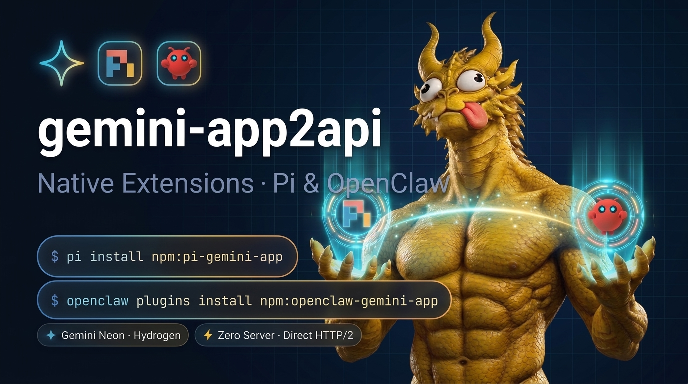
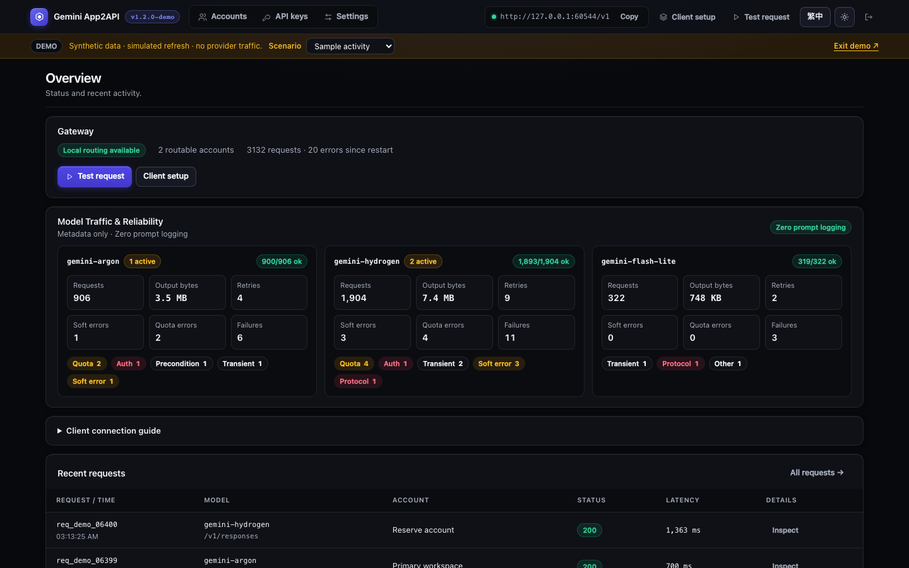
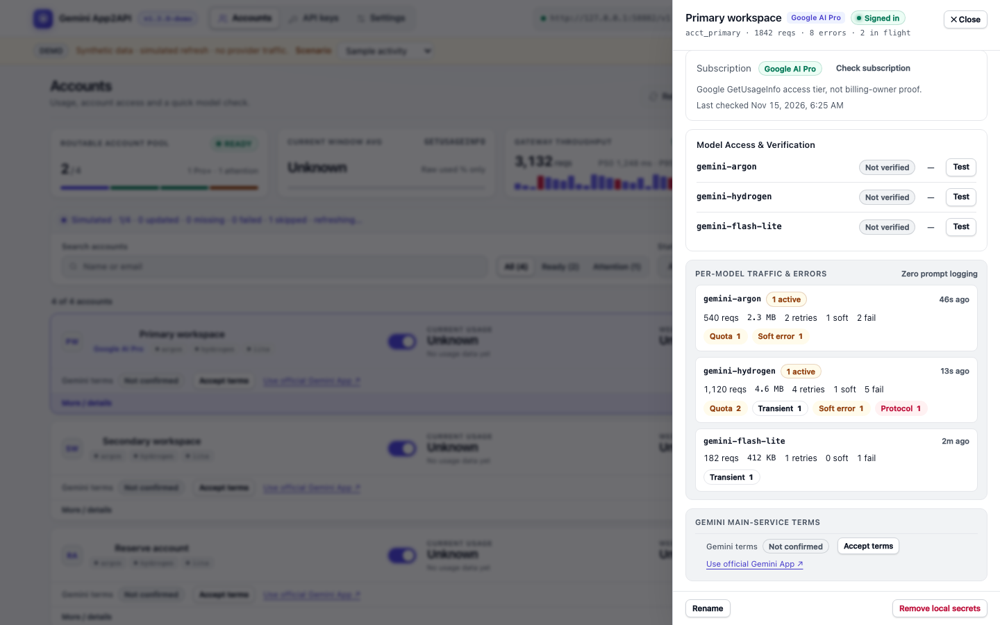
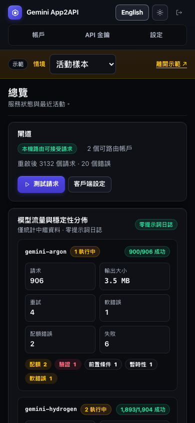

<div align="center">

# Gemini App2API

**你的编码 Agent、你的 Gemini 订阅账户、零依赖原生 HTTP/2。**

通过免服务器的独立进程内插件，或支持多账户池化与原生 `POST /mcp` 的纯 Node.js 网关，将你符合资格的 Google Gemini 账户直接接入 **Pi**、**OpenClaw**、**OpenCode**、**Claude Code**、**Cursor**、**Cline**、**Roo Code**、**Codex CLI**、**MCP 客户端**与官方 OpenAI SDK。

[](https://github.com/ShawTim/gemini-app2api/actions/workflows/ci.yml)
[](https://www.npmjs.com/package/pi-gemini-app)
[](https://pi.dev/packages/pi-gemini-app?name=pi-gemini-app)
[](https://www.npmjs.com/package/openclaw-gemini-app)
[](https://clawhub.ai/shawtim/plugins/openclaw-gemini-app)
[](https://www.npmjs.com/package/opencode-gemini-app)
[](https://www.npmjs.com/package/mcp-gemini-app)


[](LICENSE)

[English](README.md) · [繁體中文](README.zh.md) · **简体中文** · [快速开始](#quick-start) · [连接客户端](#connect-your-client) · [模型与配额](#quota-consumption) · [API 参考](docs/API_SUPPORT.md) · [运维指南](docs/OPERATIONS.md)

</div>

> [!IMPORTANT]
> **非官方互通性研究项目。** 与 Google 无任何关联或背书关系。你必须使用本人符合资格的 Google 账户亲自登录；本项目不分发任何凭据、Token 或 Google 二进制文件。详见 [DISCLAIMER.md](DISCLAIMER.md)。

---

<a id="quick-start"></a>
## 快速开始

### 路线 A — 独立原生插件（无需启动网关服务器）



<a id="pi-extension"></a><a id="openclaw-plugin"></a>

| 客户端 | 安装／运行命令 | 登录与查询配额 | 包链接与说明 |
|---|---|---|---|
| **Pi / GooeyPi** | `pi install npm:pi-gemini-app` | `/login gemini-app` · `/gemini-quota` | [npm](https://www.npmjs.com/package/pi-gemini-app) · [Pi Packages](https://pi.dev/packages/pi-gemini-app?name=pi-gemini-app) · [说明](extensions/pi/README.md) |
| **OpenClaw** | `openclaw plugins install openclaw-gemini-app` *（或 `npm:openclaw-gemini-app`）* | `openclaw models auth login --provider gemini-app` · `/usage` | [npm](https://www.npmjs.com/package/openclaw-gemini-app) · [ClawHub](https://clawhub.ai/shawtim/plugins/openclaw-gemini-app) · [说明](extensions/openclaw/README.md) |
| **OpenCode** | 在 `opencode.json` 中加入 `"plugin": ["opencode-gemini-app"]` | `/connect`（`gemini-app`） | [npm](https://www.npmjs.com/package/opencode-gemini-app) · [说明](extensions/opencode/README.md) |
| **独立 MCP（stdio）** | `npx -y mcp-gemini-app` | `npx -y mcp-gemini-app login` · `quota` | [npm](https://www.npmjs.com/package/mcp-gemini-app) · [说明](extensions/mcp/README.md) |

全部独立扩展均在进程内直连原生 HTTP/2（`15s` PING 保活、`HTTPS_PROXY` 支持、256 工具声明、并发多图上传、免费账户自动切换 `gemini-auto`）。

### 路线 B — 自托管 OpenAI 兼容与 MCP 网关服务器

需要 **Node.js `>= 22`**（macOS / Linux / WSL2）或 **Docker Compose**，以及具备 Gemini 访问权限的 Google 账户（AI Studio API Key 属于不同服务）。

**Node.js：**

```sh
git clone https://github.com/ShawTim/gemini-app2api.git && cd gemini-app2api
npm ci --omit=dev --ignore-scripts
npm start
```

**Docker Compose：**

```sh
git clone https://github.com/ShawTim/gemini-app2api.git && cd gemini-app2api
read -r -s -p '管理员密码（至少 12 位）: ' GATEWAY_ADMIN_PASSWORD; echo
export GATEWAY_ADMIN_PASSWORD && docker compose up -d --build
```

<details>
<summary><strong>或直接运行 GHCR 预构建多架构镜像（<code>linux/amd64</code> &amp; <code>linux/arm64</code>）</strong></summary>

```sh
read -r -s -p '管理员密码（至少 12 位）: ' GATEWAY_ADMIN_PASSWORD; echo
docker run -d --name gemini-app2api --init --restart unless-stopped \
  -p 127.0.0.1:18989:18989 -p 127.0.0.1:18765:18765 \
  -v gemini-gateway-state:/data \
  --read-only --cap-drop ALL --security-opt no-new-privileges \
  --tmpfs /tmp:rw,noexec,nosuid,size=16m \
  -e GATEWAY_HOST=0.0.0.0 -e GATEWAY_CALLBACK_HOST=0.0.0.0 -e GATEWAY_ALLOW_REMOTE=1 \
  -e GATEWAY_PUBLIC_ORIGIN=http://127.0.0.1:18989 -e GATEWAY_ADMIN_PASSWORD \
  ghcr.io/shawtim/gemini-app2api:latest
```

自定义端口、TLS 反向代理与远程 SSH 隧道请参见[运维指南](docs/OPERATIONS.md#docker--linux-loopback-publishing--linux-docker-本機發佈)。

</details>

**在浏览器中完成配置：** 打开 **http://127.0.0.1:18989/admin/** → **账户 → + Google 登录** → 点击 **测试** 验证权限 → **API 密钥 → 创建密钥**。

---

<a id="connect-your-client"></a>
## 连接客户端

| 配置项 | 填写值 |
|---|---|
| **Base URL** | `http://127.0.0.1:18989/v1` *（或 Compose 内网 `http://gateway:18989/v1`／自定义 HTTPS 代理）* |
| **MCP 端点** | `http://127.0.0.1:18989/mcp` *（Streamable HTTP；可在后台 **设置** 一键开关；stdio 桥接可用 `bin/gemini-gateway mcp`）* |
| **API Key** | 在后台 **API 密钥** 中创建的客户端密钥 *（同时鉴权 `/v1/*` 与 `/mcp`）* |
| **模型** | `gemini-neon` *（旗舰 Pro；`gemini-argon` 自动别名为此）*、`gemini-hydrogen` *（高速）*、`gemini-flash-lite` |
| **端点** | `GET /v1/models` · `POST /v1/chat/completions` · `POST /v1/responses` · `POST /mcp`（[完整规格](docs/API_SUPPORT.md)） |

```sh
curl -fsS http://127.0.0.1:18989/v1/chat/completions \
  -H "Authorization: Bearer $GEMINI_GATEWAY_KEY" \
  -H "Content-Type: application/json" \
  -d '{"model":"gemini-neon","messages":[{"role":"user","content":"你好！"}]}'
```

<details>
<summary><strong>常用客户端配置模板 — MCP（Claude Code / Cursor / Windsurf / VS Code）、Codex CLI、Cline / Roo Code、Cherry Studio、OpenAI SDK</strong></summary>

- **MCP 客户端（Streamable HTTP — Claude Code、Cursor、Windsurf、Cline）** —— 通过网关多账户池提供 `ask_gemini`、`gemini_search`、`gemini_quota` 工具（严格 JSON，可在管理台一键复制）：
  ```json
  {
    "mcpServers": {
      "gemini-app": {
        "type": "http",
        "url": "http://127.0.0.1:18989/mcp",
        "headers": {
          "Authorization": "Bearer ${GEMINI_GATEWAY_KEY}"
        }
      }
    }
  }
  ```
  - **VS Code（`.vscode/mcp.json`）：** 顶层键请改用 `"servers"` 并加上 `"type": "http"`。
  - **Codex CLI（`~/.codex/config.toml`）：** 请使用 `[mcp_servers.gemini_app]` 配合 `url = "http://127.0.0.1:18989/mcp"` 与 `bearer_token_env_var = "GEMINI_GATEWAY_KEY"`。
  - **纯 stdio MCP 客户端（如 Claude Desktop）：** 运行本地部署路径 `node /path/to/gemini-app2api/bin/gemini-gateway mcp`（配置 `GEMINI_GATEWAY_URL` + `GEMINI_GATEWAY_API_KEY`），或使用独立版 [`extensions/mcp`](extensions/mcp/README.md)。
- **OpenAI Codex CLI（`~/.codex/config.toml`）** —— 原生 `/v1/responses` 与 `namespace` 工具：
  ```toml
  model = "gemini-hydrogen" # 或 "gemini-neon"
  model_provider = "gemini_app2api"
  model_reasoning_summary = "none"
  web_search = "disabled"

  [model_providers.gemini_app2api]
  name = "Gemini App2API"
  base_url = "http://127.0.0.1:18989/v1"
  env_key = "GEMINI_GATEWAY_KEY"
  wire_api = "responses"
  ```
- **Cline / Roo Code：** 选择 `OpenAI Compatible`，Base URL 填 `http://127.0.0.1:18989/v1`，模型填 `gemini-hydrogen` 或 `gemini-neon`。
- **Cursor：** Settings → Models 新增 `gemini-neon` / `gemini-hydrogen` → 开启 Override OpenAI Base URL（若经过 Cursor 云端中继需配置 HTTPS 隧道）。
- **Cherry Studio / Open WebUI / SDK：** 新增 OpenAI Provider 指向 `http://127.0.0.1:18989/v1`；完整示例见 [`examples/client.mjs`](examples/client.mjs) 与 [`examples/client.py`](examples/client.py)。

</details>

---

<a id="quota-consumption"></a>
## 模型与配额

| 模型别名 | 定位 | 原生模式 | 建议 `context_window` |
|---|---|---:|---|
| **`gemini-neon`** | Gemini 4 Neon 旗舰 Pro 深度推理与开发（`gemini-argon` 自动别名为此） | `PRO` (`3`) | `512,000` |
| **`gemini-hydrogen`** | Gemini 4 Hydrogen 低延迟日常推理（快 ~1.7–2.6 倍、更省额度） | `FAST` (`1`) | `512,000` |
| **`gemini-flash-lite`** | 高吞吐轻量任务 | `6` | — |

Gemini AI Pro 账户实测 `GetUsageInfo` 参考数据（`neon_pro_policy`，非官方 SLA 承诺）：

| 工程负载 | `gemini-hydrogen` | `gemini-neon` | Neon 倍率 |
|---|---|---|---:|
| 大型 Code Review＋全文件重写（`thinking=2`） | 每周 `~0.12%`（`~76s`） | 每周 `~0.25%`（`~198s`） | `~2.0×` |
| 多工具 Agent 调用步骤（`thinking=2`） | 每周 `~0.024%`（`~8s`） | 每周 `~0.037%`（`~14s`） | `~1.56×` |
| 标准 ~14 KB 规划输出（`thinking=0`） | 每周 `~0.017%`（`~28s`） | 每周 `~0.086%`（`~36s`） | `~5.1×` |
| 单账户 5 小时滚动窗口推估容量 | `~40` 次大重写 / `~210` 次工具步 | `~20` 次大重写 / `~135` 次工具步 | — |

---

## 为什么选择 Gemini App2API？

<p align="center">
  
  <br />
  <sub><strong>MGGA — Make Gemini Great Again：</strong>将顶级 Gemini 模型从消费级聊天外壳解放到真正的工程工具链。</sub>
</p>

| 对比维度 | **Gemini App2API** | 网页版 / Cookie 爬虫 | 桌面 App 注入 / MITM |
|---|---|---|---|
| **底层传输** | 纯 Node.js 原生 HTTP/2（`ProcessQuery`）＋并发图片上传 | 脆弱 DOM / 浏览器 Cookie | Hook 本地二进制 / 拦截 |
| **认证与池化** | 标准 Google OAuth（`0600` 私密状态）、多账户容错与用量条 | Cookie 频繁过期 / 验证码 | 绑定单一桌面 GUI 窗口 |
| **Agent 稳定性** | 256 工具 Schema 校验、抑制幻觉工具返回、`incomplete: true` 契约 | 无结构校验、易死循环 | 受限于消费级功能 |
| **运行环境** | Node.js `>= 22`，**`0` 个第三方生产环境依赖** | Playwright / Python 栈 | 绑定系统与 App 版本 |

**核心亮点：**
- **稳定传输与代理支持：** `15s` HTTP/2 `PING`＋TCP 保活、零依赖 `HTTPS_PROXY` / `HTTP_PROXY` / `NO_PROXY` 隧道、关机重启返回可重试 `503 SERVER_SHUTDOWN`，以及有界自动恢复。
- **专为长流程 E2E 与 Agent 循环打造：** 支持最多 `256` 个工具声明（`512 KiB` / `16,384` 节点）、结构化输出（`json_schema` / `json_object`）、可选 `native_search` 网页引用，以及并发 HTTP/2 多图上传（安全护栏 `256` 张／单张 `20 MiB`＋同账户纯内存 `blobId` 缓存）。
- **零依赖安全与三语管理台：** `0700`/`0600` 私密状态、`scrypt` 密码哈希、SHA-256 密钥库、CSRF/Origin 防护、`POST /mcp` 一键开关与接入模板，以及零提示词日志的账户 × 模型实时观测后台（`English` / `繁體中文` / `简体中文`）。



<details>
<summary><strong>更多管理台截图（浅色主题 &amp; 移动端中文）</strong></summary>

| 浅色主题 —— 账户侧栏详情 | 移动端 —— 中文界面 |
|---|---|
|  |  |

</details>

---

## 文档索引

| 文档 | 说明 |
|---|---|
| [Pi 扩展（`extensions/pi/README.md`）](extensions/pi/README.md) | 适用于 Pi Coding Agent 与 GooeyPi 的独立 `pi-gemini-app` 插件 |
| [OpenClaw 插件（`extensions/openclaw/README.md`）](extensions/openclaw/README.md) | 适用于 OpenClaw 与 ClawHub 的独立 `openclaw-gemini-app` Provider 插件 |
| [OpenCode 插件（`extensions/opencode/README.md`）](extensions/opencode/README.md) | 适用于 OpenCode（Bun 与 Node）的独立 `opencode-gemini-app` 原生 Provider 插件 |
| [MCP 服务器（`extensions/mcp/README.md`）](extensions/mcp/README.md) | 独立 stdio MCP 服务器（`ask_gemini`、`gemini_search`、`gemini_quota`） |
| [API 支持规格（`docs/API_SUPPORT.md`）](docs/API_SUPPORT.md) | 端点、工具、结构化输出、图片、`native_search` 与错误码 |
| [运维指南（`docs/OPERATIONS.md`）](docs/OPERATIONS.md) | `.env` 配置、Docker Compose、TLS 反向代理、`launchd` 与故障排查 |
| [完成与失败语义（`docs/COMPLETION_CONTRACT.md`）](docs/COMPLETION_CONTRACT.md) | 部分输出保留、零输出 `GENERATION_FAILED` 与 Agent 循环安全 |
| [账户生命周期（`docs/ACCOUNT_LIFECYCLE.md`）](docs/ACCOUNT_LIFECYCLE.md) · [限额与锁定（`docs/LOCKS_AND_LIMITS.md`）](docs/LOCKS_AND_LIMITS.md) | OAuth、ToS 条款、配额遥测、并发与负载边界 |
| [测试契约（`docs/CURRENT_CONTRACT_TESTS.md`）](docs/CURRENT_CONTRACT_TESTS.md) · [安全性（`SECURITY.md`）](SECURITY.md) · [更新日志（`CHANGELOG.md`）](CHANGELOG.md) | 离线 E2E 测试集、安全模型与版本历史 |

---

<div align="center">

[MIT 许可证](LICENSE) · [免责声明](DISCLAIMER.md) · [安全策略](SECURITY.md) · [贡献指南](CONTRIBUTING.md)

<sub>非官方自托管互通性软件。不分发任何 Google 二进制文件、凭据、Token、账户或模型额度。</sub>

</div>
