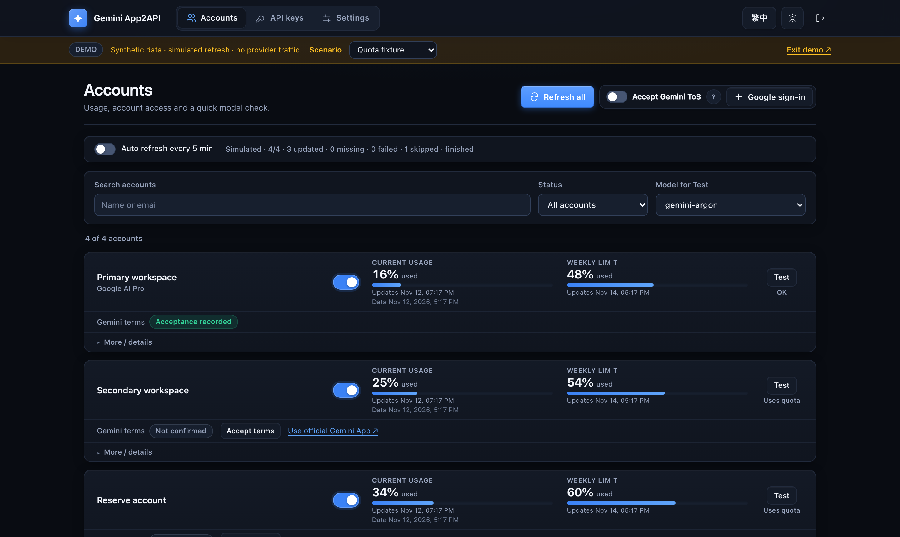
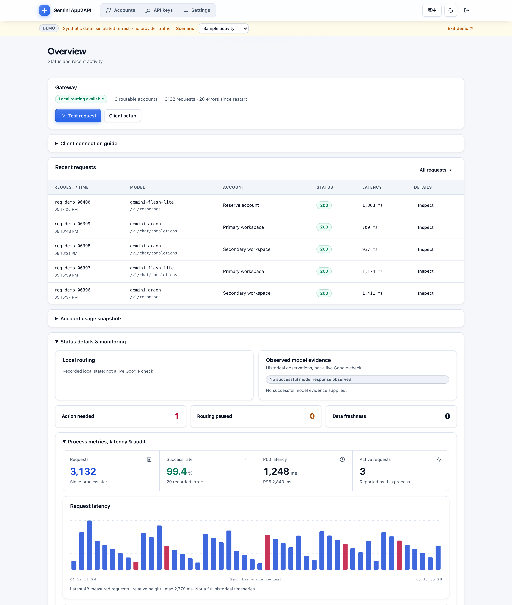
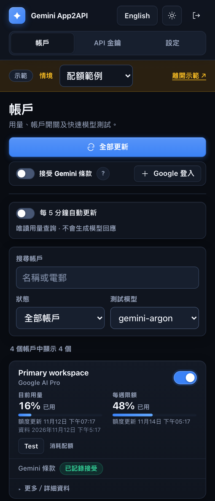

<div align="center">

# Gemini App2API

**你的開發工具、你的 Gemini 訂閱帳戶、一個零依賴的原生 HTTP/2 獨立閘道。**

透過自行部署的純 Node.js 閘道，將你名下合資格的 Gemini 帳戶直接接上 OpenAI 相容 IDE、CLI Agent 與官方 SDK —— 支援增量 SSE 串流、客戶端工具驗證、多帳戶容錯移轉與雙語維運後台。

[](https://github.com/ShawTim/gemini-app2api/actions/workflows/ci.yml)


[](LICENSE)

[English](README.md) · **繁體中文** · [快速開始](#quick-start) · [連接客戶端](#connect-your-client) · [API 參考](docs/API_SUPPORT.md) · [維運指南](docs/OPERATIONS.md)

</div>

> [!IMPORTANT]
> **非官方互通性研究專案。** 本專案與 Google 無任何關聯、合作或背書關係。使用第三方客戶端或閘道可能違反 Google 服務條款 —— 你的帳戶，風險自負。你需要自行準備合資格的 Google 帳戶與相容的 OAuth client profile；本專案不分發任何憑證、Token 或 Google 二進位程式。請先詳閱完整[免責聲明](DISCLAIMER.md)。



---

## 為什麼需要 Gemini App2API？

為什麼在官方 Gemini App 內處理大型程式開發時總是綁手綁腳、容易遺失上下文？**瓶頸往往不在底層模型，而在於官方 App 面向一般消費者所設計的封閉外殼（Harness）。**

- **將模型解放到真正的工程工具鏈：** 透過標準 `/v1/chat/completions` 與 `/v1/responses` 介面，直接連接 **Cursor、Cline、Roo Code、OpenAI Codex CLI、PI-Desktop、Cherry Studio 或 Open WebUI**，由你的本地客戶端完整掌管對話歷史與專案工具執行。
- **原生 HTTP/2 協定直連（非脆弱網頁爬蟲）：** 直接使用 Node.js 內建模組（`node:http2`、`node:crypto`）實作 Gemini Robin 原生 HTTP/2 傳輸與可續傳圖片上傳，不依賴無頭瀏覽器、網頁 Cookie 擷取或修改桌面版二進位檔案。
- **多帳戶池應對滾動額度視窗：** 高強度 Agent 多輪工具呼叫容易迅速觸及單一帳戶的 5 小時或每週滾動上限。支援匯集多個你合法持有的帳戶，提供軟性 Session 路由偏好、唯讀官方用量進度條與自動配額容錯（Failover）。
- **專為 Agent 迴圈穩定性設計：** 當上游長連線在中途斷開時，自動保留已送出的可用程式碼與工具呼叫並平穩收尾，防止 Agent 客戶端丟棄數千 bytes 已生成內容或陷入無限重送整份歷史的死循環（詳見[完成與失敗語義](docs/COMPLETION_CONTRACT.md)）。
- **誠實標示上游邊界：** 解耦本地客戶端並不代表繞過 Google 伺服器管控；所有上游 Context 容量、頻率限制、安全審查與帳戶方案權限依然由 Google 強制執行。

### 架構方案比較

| 比較維度 | **Gemini App2API** | 網頁版 / Cookie 爬蟲方案 | 桌面 App 注入 / 流量攔截 |
|---|---|---|---|
| **底層傳輸** | 原生 HTTP/2（`ProcessQuery`）＋原生可續傳圖片上傳 | 脆弱的網頁 DOM 解析或逆向瀏覽器 Cookie | Hook 本機二進位檔或 MITM 攔截 |
| **驗證週期** | 標準 Google OAuth ＋ 本機 `0600` 私密 Refresh Token | Cookie 頻繁過期、易觸發驗證碼阻擋 | 綁定單一開啟中的桌面 GUI 視窗 |
| **工具呼叫** | 嚴格 JSON Schema 驗證提示詞協定 ＋ Responses `namespace` | 缺乏結構驗證或僅靠鬆散正規表示式 | 受限於消費級聊天介面既有功能 |
| **多帳戶調度** | 帳戶池路由、軟性 Session 親和度、批量官方用量與訂閱查詢 | 需手動替換 Cookie | 僅限當前桌面登入之單一帳號 |
| **執行環境依賴** | 純 Node.js `>= 22`，**`0` 個第三方生產環境 npm 套件** | 需安裝 Playwright / Puppeteer 或龐大依賴 | 綁定特定作業系統與特定 App 版本 |

<details>
<summary>🧢 <strong>專案口號 —— MGGA（Make Gemini Great Again）</strong></summary>
<br />
<p align="center">
  
</p>
<p align="center"><em>頂級基礎模型，值得配上一流的本地開發者工具鏈。</em></p>
</details>

---

## 核心特色

- **精確定義的 OpenAI 相容介面（`Chat` 與 `Responses`）：** 支援 `GET /v1/models`、`POST /v1/chat/completions` 與 `POST /v1/responses`，涵蓋 JSON 與增量 SSE 串流、`reasoning_effort` / `reasoning.effort` 思考強度對應，以及靜態 PNG/JPEG/WebP 圖片輸入。
- **客戶端自主工具權限（Caller-Owned Tools）：** 由客戶端宣告函數與 JSON Schema（含 Responses `type: "namespace"` 工具分組）、在本機執行獲准呼叫並回傳結果；閘道嚴格驗證工具名稱與參數結構，絕不代為執行 Shell 指令或存取你的專案目錄。
- **零第三方 Runtime 依賴與嚴密安全邊界：** 零外部生產套件；強制檢查 `0700`/`0600` 私密目錄與檔案權限、採用 `scrypt` 管理密碼雜湊、SHA-256 客戶端金鑰雜湊、嚴格 `Origin`/`Host`/`X-CSRF-Token` 後台寫入保護，以及預設關閉且具 SSRF 防護的公開圖片下載。
- **中英雙語現代化維運後台（`English` / `繁體中文`）：** 支援桌面與手機響應式檢視、深淺色主題、一鍵批量唯讀更新 **目前用量（Current usage）** 與 **每週限額（Weekly limit）**、明確記錄或確認接受 Gemini 服務條款、簽發客戶端 API 金鑰及檢視遮罩後的上游 HTTP/gRPC 診斷資訊。

| 淺色主題 —— 系統總覽與延遲觀測 | 手機版後台 —— 繁體中文介面 |
|---|---|
|  |  |

---

<a id="quick-start"></a>
## 快速開始

### 1. 準備工作

- **Node.js 22+**（`>= 22.0.0`）、npm、現代瀏覽器，以及具備相應 Gemini 模型權限的 Google 帳戶（適用於 macOS 與 Linux）。
- 從**獲授權的私密來源取得相容的靜態 OAuth client profile**（本儲存庫不隨附任何憑證，亦無法以 Google AI Studio API key 替代）。請先參閱[私密初始化與 Profile 格式要求](docs/OPERATIONS.md#private-initial-setup--私密初始化)。

### 2. 初始化並啟動閘道

在專案根目錄執行：

```sh
npm ci --omit=dev --ignore-scripts
export GATEWAY_DATA_DIR="$HOME/.gemini-app2api"

# 建立權限為 0600 的私密 .env 設定檔（若已存在則不覆寫）：
test -e .env || cp .env.example .env
chmod 600 .env
# 編輯 .env，將 GATEWAY_ADMIN_PASSWORD 設為獨立的 12–256 字元密碼。

node bin/gemini-gateway init
node bin/gemini-gateway import-profile < /private/path/oauth-profile.json
node bin/gemini-gateway start
```

> **偏好使用 Docker？** 請參閱強化安全設定的 [Docker Compose 部署指南](docs/OPERATIONS.md#docker--linux-loopback-publishing--linux-docker-本機發佈)（預設以 `uid 1000`、唯讀根目錄、最小權限及本機 loopback 連接埠運行）。

### 3. 登入 Google 帳戶並建立客戶端金鑰

在瀏覽器開啟 **http://127.0.0.1:18989/admin/**：

1. 輸入 `GATEWAY_ADMIN_PASSWORD` 登入後台（若留空，僅限本機 loopback 免密碼管理；遠端連線必須設定密碼與 [TLS 反向代理](docs/OPERATIONS.md#remote-access-with-tls--遠端-tls)）。
2. 在 **帳戶（Accounts）** 頁面點擊 **+ Google 登入**，親自於瀏覽器完成 Google 授權與 MFA 驗證。
3. 在帳戶卡片點擊 **Test** 測試模型連線（注意：**Test** 會發送真實請求並消耗配額；單純完成 OAuth 登入不代表模型權限已驗證）。
4. 前往 **API 金鑰（API keys）→ 建立金鑰**，複製並妥善保存僅顯示一次的客戶端金鑰。

---

<a id="connect-your-client"></a>
## 連接你的客戶端

在任何支援自訂 **OpenAI 相容介面**的客戶端填入以下設定：

| 設定項目 | 填寫內容 |
|---|---|
| **Base URL** | `http://127.0.0.1:18989/v1`（遠端部署請填寫已設定的 HTTPS 閘道網址 `/v1`） |
| **API Key** | 在管理後台 **API 金鑰**頁面建立的 client key（切勿填寫管理員密碼或 Google token） |
| **Model** | `gemini-argon`（旗艦推理與編碼模式）、`gemini-flash` 或 `gemini-flash-lite` |
| **API 類型** | `/v1/chat/completions` 或 `/v1/responses`（以[支援契約](docs/API_SUPPORT.md)為準） |

測試模型清單連線（不消耗生成額度）：

```sh
curl -fsS http://127.0.0.1:18989/v1/models \
  -H "Authorization: Bearer $GEMINI_GATEWAY_KEY"
```

發送對話請求（如需增量串流，請在 JSON 加入 `"stream": true` 並搭配 `curl -N`）：

```sh
curl -fsS http://127.0.0.1:18989/v1/chat/completions \
  -H "Authorization: Bearer $GEMINI_GATEWAY_KEY" \
  -H "Content-Type: application/json" \
  -d '{"model":"gemini-argon","messages":[{"role":"user","content":"Hello!"}]}'
```

### 常用客戶端設定範例

<details>
<summary><strong>Cursor</strong></summary>

1. 開啟 **Cursor Settings → Models**。
2. 新增自訂模型名稱 `gemini-argon`（亦可一併加入 `gemini-flash`）。
3. 開啟 **Override OpenAI Base URL**，填入你的閘道 `/v1` 網址（若 Cursor 雲端轉發模式要求公開 HTTPS，請搭配你的私人 TLS 反向代理網址），並貼上客戶端 API 金鑰。

</details>

<details>
<summary><strong>Cline / Roo Code（VS Code）</strong></summary>

1. **API Provider** 選擇 `OpenAI Compatible`。
2. **Base URL：** `http://127.0.0.1:18989/v1`
3. **API Key：** 貼上後台建立的 client key。
4. **Model ID：** `gemini-argon`（完整支援增量串流、多輪本地工具呼叫與靜態圖片輸入）。

</details>

<details>
<summary><strong>OpenAI Codex CLI（<code>~/.codex/config.toml</code>）</strong></summary>

Codex CLI 原生支援 `/v1/responses` 協定（包含 `namespace` 工具分組與 `reasoning.effort` 對應）：

```toml
model = "gemini-argon"
model_provider = "gemini_app2api"
model_reasoning_summary = "none"
web_search = "disabled"

[model_providers.gemini_app2api]
name = "Gemini App2API"
base_url = "http://127.0.0.1:18989/v1"
env_key = "GEMINI_GATEWAY_KEY"
wire_api = "responses"
```

</details>

<details>
<summary><strong>Cherry Studio / Open WebUI / 官方 OpenAI SDK</strong></summary>

- **Cherry Studio / Open WebUI：** 新增 OpenAI 相容服務商，API 位址填寫 `http://127.0.0.1:18989/v1` 並貼上 client key，即可自動讀取 `gemini-argon`、`gemini-flash`、`gemini-flash-lite`。
- **官方 JavaScript 與 Python SDK：** 儲存庫內附完整的多輪工具呼叫範例 [`examples/client.mjs`](examples/client.mjs) 與 [`examples/client.py`](examples/client.py)。請注意每一輪請求都必須回傳完整對話歷史（含原始 `tool_call_id` / `call_id` 與工具結果）。

</details>

---

## 模型與支援能力

| 模型別名 | 定位與用途 | Native Mode | 公布的 Context Metadata |
|---|---|---:|---|
| **`gemini-argon`** | **旗艦 Pro 級推理與程式開發模式**，適合複雜架構設計與多輪 Agent 任務 | `8` | `context_window: 128000`（客戶端建議預算） |
| **`gemini-flash`** | 低延遲日常推理與快速互動任務 | `FAST`（`1`） | 未公布 |
| **`gemini-flash-lite`** | 高吞吐、輕量級快速回應任務 | `6` | 未公布 |

> 模型別名對應 Gemini App 原生執行模式，並非 Google Cloud Vertex / AI Studio 的固定版本代號；實際可用性取決於各登入帳戶的上游方案權限。`context_window: 128000` 為提供給客戶端作本地上下文管理的建議值，並非閘道強制截斷上限或上游保證容量。

| 功能項目 | 支援範圍 |
|---|---|
| **API 端點** | `GET /v1/models`、`POST /v1/chat/completions`、`POST /v1/responses` |
| **函數工具** | 支援有界 JSON Schema 驗證、`auto`/`none`/`required`/指定函數 `tool_choice` 及 Responses 純函數 `namespace` 分組；工具一律由客戶端執行 |
| **圖片輸入** | 單次請求最多 `4` 張靜態 PNG / JPEG / WebP（合計 `<= 2 MiB`），支援 `data:` URL 及預設關閉、具 SSRF 防護的公開 HTTP(S) 圖片網址 |
| **Google 搜尋** | 明確傳入 `"native_search": true`（限 `gemini-argon`、thinking `2`、純文字 `<= 16 KiB`，且不可同輪混用客戶端工具或圖片） |
| **思考控制** | 支援同步 `thinking_level`（`0`、`1`、`2`、`4`，預設 `2`）與 OpenAI `reasoning_effort`（`none`/`minimal`→`0`、`low`→`1`、`medium`/`high`/`xhigh`→`2`）；非同步 Deep Think（`3`）會於本機直接拒絕 |
| **用量統計** | 回傳標示 `estimated: true` 的啟發式 token 估算值，並非 Google 官方精確計費數據 |

---

## 安全運行與操作原則

- **嚴格保護私密憑證：** 切勿公開或提交 `.env`、OAuth client profile、refresh token、API 金鑰或 `GATEWAY_DATA_DIR` 目錄。詳見[安全性政策](SECURITY.md)。
- **對話歷史與執行權歸屬客戶端：** 閘道不會代執行任何本機指令、不會暗中摘要或刪減歷史訊息，亦絕不在上游發生降級時暗中替換成低階模型。
- **誠實標示中斷與未完成狀態：** 已輸出可用內容但中途斷線的串流會附帶明確的 `incomplete: true` 標記收尾，以保護客戶端已收到的工作成果；若需判斷上游是否完整結束，請一併檢查 `incomplete` 欄位。詳見[完成與失敗語義](docs/COMPLETION_CONTRACT.md)。
- **審慎配置自動恢復：** 開啟 `GATEWAY_QUOTA_FAILOVER=1` 或 `GATEWAY_AUTOMATIC_RECOVERY=1` 可在單一帳戶觸頂或瞬斷時自動切換其他合資格帳戶，但故障重試亦可能消耗額外配額。詳見[維運設定](docs/OPERATIONS.md#configuration--設定)與[鎖與限制清單](docs/LOCKS_AND_LIMITS.md)。

---

## 文件索引

| 文件 | 說明 |
|---|---|
| [API 支援契約（`docs/API_SUPPORT.md`）](docs/API_SUPPORT.md) | 端點規格、事件順序、工具驗證、圖片上傳、原生搜尋與錯誤碼對照 |
| [維運指南（`docs/OPERATIONS.md`）](docs/OPERATIONS.md) | 私密初始化、`.env` 設定、Docker Compose、遠端 TLS、`launchd` 常駐與排錯 |
| [帳戶生命週期（`docs/ACCOUNT_LIFECYCLE.md`）](docs/ACCOUNT_LIFECYCLE.md) | Google OAuth 登入、明確條款同意、唯讀訂閱層級與官方配額讀取語義 |
| [完成與失敗語義（`docs/COMPLETION_CONTRACT.md`）](docs/COMPLETION_CONTRACT.md) | 部分輸出保留原則、`GENERATION_FAILED` 零輸出終局合約與責任分類 |
| [鎖、拒收規則與限制（`docs/LOCKS_AND_LIMITS.md`）](docs/LOCKS_AND_LIMITS.md) | 並行容量、記憶體／封包大小上限、請求合併機制與無鎖化設計 |
| [離線契約測試（`docs/CURRENT_CONTRACT_TESTS.md`）](docs/CURRENT_CONTRACT_TESTS.md) | 離線合成測試套件、[測試執行安全邊界](docs/TEST_EXECUTION_SAFETY.md)與[開發依賴清單](docs/DEPENDENCIES.md) |
| [安全性（`SECURITY.md`）](SECURITY.md) · [貢獻指南（`CONTRIBUTING.md`）](CONTRIBUTING.md) | 威脅邊界、私密漏洞通報流程與程式碼貢獻規範 |
| [更新日誌（`CHANGELOG.md`）](CHANGELOG.md) · [免責聲明（`DISCLAIMER.md`）](DISCLAIMER.md) | 版本變更紀錄與帳戶風險／法律聲明 |

---

<div align="center">

[MIT License](LICENSE) · [免責聲明](DISCLAIMER.md) · [安全性政策](SECURITY.md)

<sub>非官方自行部署互通性研究軟體；不分發任何 Google 二進位程式、OAuth client profile 或帳戶憑證。</sub>

</div>
