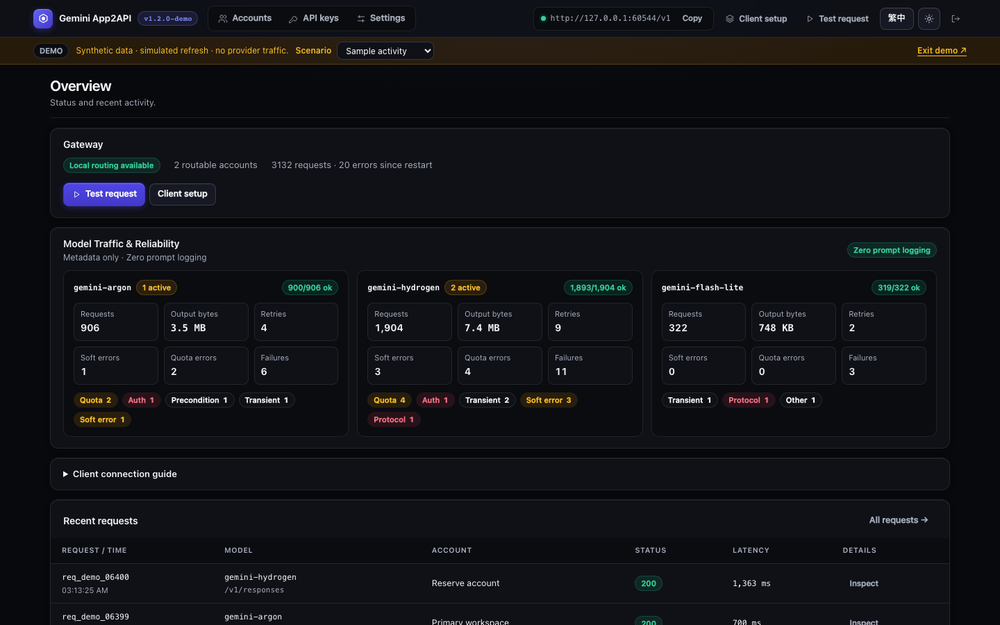
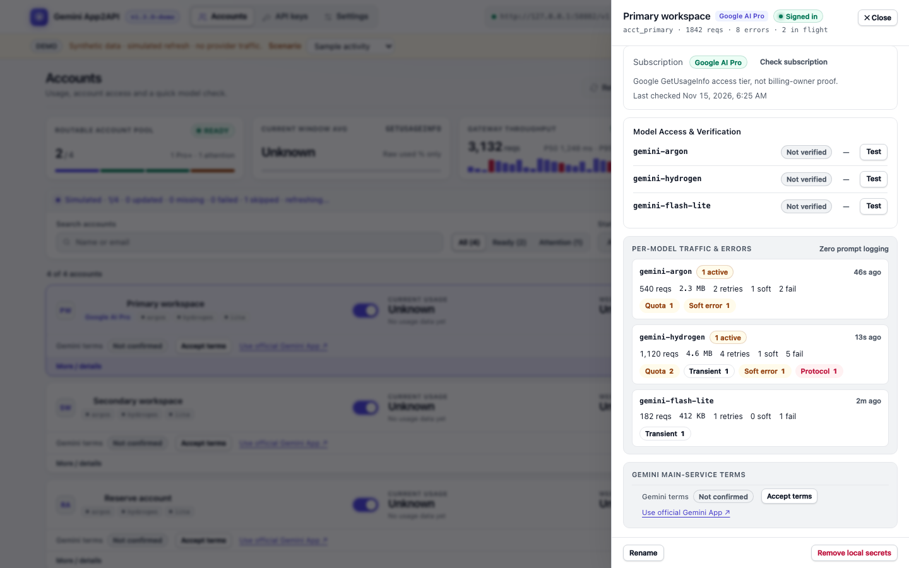
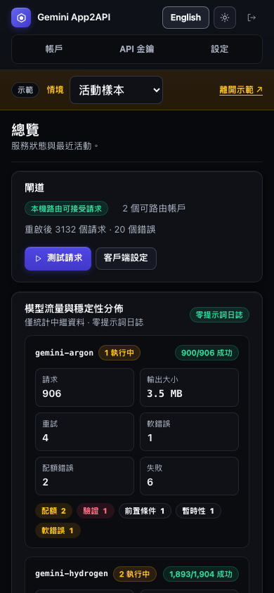
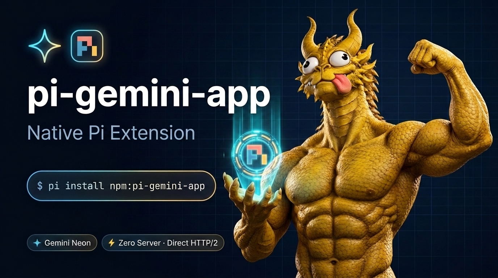

<div align="center">

# Gemini App2API

**你的開發工具、你的 Gemini 訂閱帳戶、一個零依賴的原生 HTTP/2 獨立閘道。**

透過自行部署的純 Node.js 閘道，將你名下合資格的 Gemini 帳戶直接接上 OpenAI 相容 IDE、CLI Agent 與官方 SDK（支援增量 SSE 串流、客戶端工具驗證、多帳戶容錯移轉與雙語維運後台）—— 或直接於 Pi Coding Agent 與 GooeyPi 內安裝獨立 In-Process 擴充套件 [pi-gemini-app](#pi-extension)，免啟動閘道伺服器。

[](https://github.com/ShawTim/gemini-app2api/actions/workflows/ci.yml)
[](https://www.npmjs.com/package/pi-gemini-app)


[](LICENSE)

[English](README.md) · **繁體中文** · [快速開始](#quick-start) · [Pi 擴充套件](#pi-extension) · [連接客戶端](#connect-your-client) · [API 參考](docs/API_SUPPORT.md) · [維運指南](docs/OPERATIONS.md)

</div>

> [!IMPORTANT]
> **非官方互通性研究專案。** 本專案與 Google 無任何關聯、合作或背書關係。使用第三方客戶端或閘道可能違反 Google 服務條款 —— 你的帳戶，風險自負。你必須親自以本人合資格的 Google 帳戶完成登入驗證；本專案不分發任何使用者憑證、Token、帳戶或 Google 二進位程式。請先詳閱完整[免責聲明](DISCLAIMER.md)。



---

## 為什麼需要 Gemini App2API？

<p align="center">
  
  <br />
  <sub><strong>🧢 MGGA — Make Gemini Great Again：</strong>頂級 GigaChad 底層模型，不該被困在消費級聊天外殼裡。</sub>
</p>

為什麼在官方 Gemini App 內處理大型程式開發時總是綁手綁腳、容易遺失上下文？**瓶頸往往不在底層模型，而在於官方 App 面向一般消費者所設計的封閉外殼（Harness）。**

- **將模型解放到真正的工程工具鏈：** 透過標準 `/v1/chat/completions` 與 `/v1/responses` 介面，直接連接 **Cursor、Cline、Roo Code、OpenAI Codex CLI、Pi Coding Agent、GooeyPi、PI-Desktop、Cherry Studio 或 Open WebUI**；Pi / GooeyPi 用家亦可直接安裝獨立原生 In-Process 擴充套件（`pi install npm:pi-gemini-app`），無須啟動獨立閘道。
- **原生 HTTP/2 協定直連（非脆弱網頁爬蟲）：** 直接使用 Node.js 內建模組（`node:http2`、`node:crypto`）實作 Gemini Robin 原生 HTTP/2 傳輸與可續傳圖片上傳，不依賴無頭瀏覽器、網頁 Cookie 擷取或修改桌面版二進位檔案。
- **多帳戶池應對滾動額度視窗：** 高強度 Agent 多輪工具呼叫容易迅速觸及單一帳戶的 5 小時或每週滾動上限。支援匯集多個你合法持有的帳戶，提供軟性 Session 路由偏好、唯讀官方用量進度條與自動配額容錯（Failover）。
- **專為 Agent 迴圈穩定性設計：** 當上游長連線在中途斷開時，自動保留已送出的可用程式碼與工具呼叫並平穩收尾，防止 Agent 客戶端丟棄數千 bytes 已生成內容或陷入無限重送整份歷史的死循環（詳見[完成與失敗語義](docs/COMPLETION_CONTRACT.md)）。
- **誠實標示上游邊界：** 解耦本地客戶端並不代表繞過 Google 伺服器管控；所有上游 Context 容量、頻率限制、安全審查與帳戶方案權限依然由 Google 強制執行。

### 架構方案比較

| 比較維度 | **Gemini App2API** | 網頁版 / Cookie 爬蟲方案 | 桌面 App 注入 / 流量攔截 |
|---|---|---|---|
| **底層傳輸** | 原生 HTTP/2（`ProcessQuery`）＋原生可續傳圖片上傳 | 脆弱的網頁 DOM 解析或逆向瀏覽器 Cookie | Hook 本機二進位檔或 MITM 攔截 |
| **驗證週期** | 標準 Google OAuth ＋ 本機 `0600` 私密 Refresh Token | Cookie 頻繁過期、易觸發驗證碼阻擋 | 綁定單一開啟中的桌面 GUI 視窗 |
| **工具呼叫** | 嚴格 JSON Schema 驗證提示詞協定 ＋ Responses `namespace` | 缺乏結構驗證或僅靠鬆散正規表示式 | 受限於消費級聊天介面既有功能 |
| **多帳戶調度** | 帳戶池路由、軟性 Session 親和度、批量官方用量與訂閱查詢 | 需手動替換 Cookie | 僅限當前桌面登入之單一帳號 |
| **執行環境依賴** | 純 Node.js `>= 22`，**`0` 個第三方生產環境 npm 套件** | 需安裝 Playwright / Puppeteer 或龐大依賴 | 綁定特定作業系統與特定 App 版本 |

---

## 核心特色

- **精確定義的 OpenAI 相容介面（`Chat` 與 `Responses`）：** 支援 `GET /v1/models`、`POST /v1/chat/completions` 與 `POST /v1/responses`，涵蓋 JSON 與增量 SSE 串流、結構化輸出（Structured Outputs：透過 Chat `response_format` 與 Responses `text.format` 支援 `json_schema` 及 `json_object`，送出前通過有界 JSON Schema 驗證）、`native_search` 公開網頁 `url_citation` 引用標註、`reasoning_effort` / `reasoning.effort` 思考強度對應，以及靜態 PNG/JPEG/WebP 圖片輸入。
- **客戶端自主工具權限（Caller-Owned Tools）：** 由客戶端宣告函數與 JSON Schema（含 Responses `type: "namespace"` 工具分組）、在本機執行獲准呼叫並回傳結果；閘道嚴格驗證工具名稱與參數結構，絕不代為執行 Shell 指令或存取你的專案目錄。
- **零第三方 Runtime 依賴與嚴密安全邊界：** 零外部生產套件；強制檢查 `0700`/`0600` 私密目錄與檔案權限、採用 `scrypt` 管理密碼雜湊、以 SHA-256 驗證雜湊搭配 `0600` 本機私密金鑰保存（僅於建立當下或通過驗證與 CSRF 保護後按需回傳）、嚴格 `Origin`/`Host`/`X-CSRF-Token` 後台寫入保護，以及預設關閉且具 SSRF 防護的公開圖片下載。
- **中英雙語現代化維運後台（`English` / `繁體中文`）：** 支援桌面與手機響應式檢視及深淺色主題；在 `/admin` **Overview（總覽）** 與側欄帳戶檢視器（Account Inspector Drawer）內提供帳戶池狀態脈搏、請求延遲快照圖，以及僅統計中繼資料、零提示詞日誌的各帳戶 × 各模型觀測遙測（`gemini-neon`、`gemini-hydrogen`、`gemini-flash-lite` 供應商嘗試計數——含容錯／恢復重試與手動帳戶測試——以及輸出位元組、重試、軟錯誤與錯誤分類）；支援一鍵批量唯讀更新 **目前用量（Current usage）** 與 **每週限額（Weekly limit）**、快速連接設定範本（`Codex CLI`、`Cline`、`cURL`）、可隨時複製或撤銷的 API 金鑰管理、明確記錄或確認接受 Gemini 服務條款，以及遮罩後的上游 HTTP/gRPC 診斷資訊。

| 淺色主題 —— 帳戶側欄檢視與狀態脈搏 | 手機版後台 —— 繁體中文介面 |
|---|---|
|  |  |

---

<a id="quick-start"></a>
## 快速開始

<a id="pi-extension"></a>



> [!TIP]
> **使用 Pi Coding Agent 或 GooeyPi？無須啟動獨立閘道伺服器。**
> 直接從 [npm（`pi-gemini-app`）](https://www.npmjs.com/package/pi-gemini-app) 或 Pi Marketplace 安裝零依賴原生 HTTP/2 擴充套件，免跑本地 HTTP Proxy 或 Docker 容器：
> ```sh
> pi install npm:pi-gemini-app
> ```
> 安裝後於 Pi 或 GooeyPi 內執行 `/login gemini-app` 及 `/gemini-quota`。系統會透過 `GetUsageInfo` 自動偵測帳戶訂閱方案：**免費版（Free）** Google 帳戶會自動篩選為 `gemini-auto`（Smart Model Selection），而 **AI Plus / Pro / Ultra** 付費帳戶則可使用 `gemini-neon`、`gemini-hydrogen`、`gemini-flash-lite` 與 `gemini-auto`（`gemini-argon` 暫時自動 alias 至 `gemini-neon`）。完整說明請參閱 [`extensions/pi/README.md`](extensions/pi/README.md)。

<a id="openclaw-plugin"></a>

> [!NOTE]
> **使用 OpenClaw？** 本專案亦內建零依賴獨立 Provider 插件 **`openclaw-gemini-app`**（`extensions/openclaw/`），完整共用原生 HTTP/2 傳輸、`HTTPS_PROXY` 支援、15s `PING` 保活、本機與遠端 VPS OAuth 登入及 `/usage` 配額整合（`npm run build:openclaw-package -- --clean --pack`）。完整說明請參閱 [`extensions/openclaw/README.md`](extensions/openclaw/README.md)。

### 1. 準備工作

- **Node.js 22+**（`>= 22.0.0`）（macOS、Linux 或 Windows WSL2）**或 Docker Compose**（Windows、macOS、Linux）。
- 現代瀏覽器與具備相應 Gemini 模型權限的 Google 帳戶（Google AI Studio API key 屬不同服務，無法替代）。

### 2. 啟動閘道

**方式 A — Node.js（macOS / Linux / Windows WSL2）：**

```sh
git clone https://github.com/ShawTim/gemini-app2api.git
cd gemini-app2api
npm ci --omit=dev --ignore-scripts

# 選用：建立權限為 0600 的私密 .env 設定檔（若已存在則不覆寫）：
test -e .env || (cp .env.example .env && chmod 600 .env)
# 如需設定管理員密碼，可編輯 .env 設定 GATEWAY_ADMIN_PASSWORD（12–256 字元）；留空則僅限本機 loopback 免密碼登入。

npm start
```

**方式 B — Docker Compose（Windows / macOS / Linux）：**

```sh
git clone https://github.com/ShawTim/gemini-app2api.git
cd gemini-app2api
read -r -s -p 'Runtime admin password (>= 12 chars): ' GATEWAY_ADMIN_PASSWORD; echo
export GATEWAY_ADMIN_PASSWORD
docker compose up -d --build
```

亦可直接拉取預建的多架構官方映像檔（支援 `linux/amd64` / `linux/arm64`，隨正式版 Tag 自動發佈至 GHCR，免 `git clone`）：

```sh
read -r -s -p 'Runtime admin password (>= 12 chars): ' GATEWAY_ADMIN_PASSWORD; echo
docker run -d --name gemini-app2api --init --restart unless-stopped \
  -p 127.0.0.1:18989:18989 -p 127.0.0.1:18765:18765 \
  -v gemini-gateway-state:/data \
  --read-only --cap-drop ALL --security-opt no-new-privileges \
  --tmpfs /tmp:rw,noexec,nosuid,size=16m \
  -e GATEWAY_HOST=0.0.0.0 -e GATEWAY_CALLBACK_HOST=0.0.0.0 -e GATEWAY_ALLOW_REMOTE=1 \
  -e GATEWAY_PUBLIC_ORIGIN=http://127.0.0.1:18989 \
  -e GATEWAY_ADMIN_PASSWORD \
  ghcr.io/shawtim/gemini-app2api:latest
```

> `compose.yaml` 預設僅喺本機 IPv4 loopback 發佈閘道與 OAuth 連接埠（`127.0.0.1:18989:18989`、`127.0.0.1:18765:18765`），並喺容器橋接介面上強制要求 `GATEWAY_ADMIN_PASSWORD`。共用同一個 Docker Compose 網路嘅其他容器可直接透過內部通訊埠呼叫 `http://gateway:18989/v1`（或自訂 `http://<service-name>:18989/v1`）並附上 Bearer API key；喺支援路由至主機 loopback 嘅 Docker Desktop 上，獨立容器亦可連線 `http://host.docker.internal:<published-port>/v1`。`/admin/` 嘅 `Host`/`Origin` 白名單（針對 `GATEWAY_PUBLIC_ORIGIN`，且當其為 `http://` loopback 時同時允許 `localhost` / `[::1]`）係用嚟防止瀏覽器 DNS rebinding 同 CSRF 攻擊，並唔替代本機連接埠綁定、密碼驗證或網路隔離原則。如改用獨立 `docker run`、自訂連接埠或 SSH port forwarding，請參閱 [Docker Compose 部署指南](docs/OPERATIONS.md#docker--linux-loopback-publishing--linux-docker-本機發佈)（預設以 `uid 1000`、唯讀根目錄及最小權限運行）。

### 3. 登入 Google 帳戶並建立客戶端金鑰

在瀏覽器開啟 **http://127.0.0.1:18989/admin/**（或 **http://localhost:18989/admin/**）：

1. 輸入 `GATEWAY_ADMIN_PASSWORD` 登入後台（若留空，僅限本機 loopback 免密碼管理；遠端連線必須設定密碼與 [TLS 反向代理](docs/OPERATIONS.md#remote-access-with-tls--遠端-tls)）。
2. 在 **帳戶（Accounts）** 頁面點擊 **+ Google 登入**，親自於瀏覽器完成 Google 授權與 MFA 驗證。
3. 在帳戶卡片點擊 **Test** 測試模型連線（注意：**Test** 會發送真實請求並消耗配額；單純完成 OAuth 登入不代表模型權限已驗證）。
4. 前往 **API 金鑰（API keys）→ 建立金鑰**，建立並複製客戶端金鑰（之後亦可在該頁隨時複製、顯示或撤銷有效金鑰）。

---

<a id="connect-your-client"></a>
## 連接你的客戶端

在任何支援自訂 **OpenAI 相容介面**的客戶端填入以下設定：

| 設定項目 | 填寫內容 |
|---|---|
| **Base URL** | `http://127.0.0.1:18989/v1`（同 Compose 共用網路其他容器填 `http://<service-name>:18989/v1`；支援主機路由之 Docker Desktop 獨立容器填 `http://host.docker.internal:<published-port>/v1`；遠端部署請填 HTTPS 反向代理網址 `/v1`） |
| **API Key** | 在管理後台 **API 金鑰**頁面建立的 client key（切勿填寫管理員密碼或 Google token） |
| **Model** | `gemini-neon`（Gemini 4 Neon 旗艦推理與編碼模式；`gemini-argon` 暫時自動 alias 至此）、`gemini-hydrogen`（Gemini 4 Hydrogen）或 `gemini-flash-lite` |
| **API 類型** | `/v1/chat/completions` 或 `/v1/responses`（以[支援契約](docs/API_SUPPORT.md)為準） |

測試模型清單連線（不消耗生成額度）：

```sh
curl -fsS http://127.0.0.1:18989/v1/models \
  -H "Authorization: Bearer $GEMINI_GATEWAY_KEY"
```

發送對話請求（如需增量串流，請在 JSON 加入 `"stream": true` 並搭配 `curl -N`）：

```sh
curl -fsS http://127.0.0.1:18989/v1/chat/completions \
  -H "Authorization: Bearer $GEMINI_GATEWAY_KEY" \
  -H "Content-Type: application/json" \
  -d '{"model":"gemini-neon","messages":[{"role":"user","content":"Hello!"}]}'
```

### 常用客戶端設定範例

<details>
<summary><strong>Cursor</strong></summary>

1. 開啟 **Cursor Settings → Models**。
2. 新增自訂模型名稱 `gemini-neon`（亦可一併加入 `gemini-hydrogen`）。
3. 開啟 **Override OpenAI Base URL**，填入你的閘道 `/v1` 網址（若 Cursor 雲端轉發模式要求公開 HTTPS，請搭配你的私人 TLS 反向代理網址），並貼上客戶端 API 金鑰。

</details>

<details>
<summary><strong>Cline / Roo Code（VS Code）</strong></summary>

1. **API Provider** 選擇 `OpenAI Compatible`。
2. **Base URL：** `http://127.0.0.1:18989/v1`
3. **API Key：** 貼上後台建立的 client key。
4. **Model ID：** 建議高頻率多輪 Agent 迴圈優先選用配額友善的 `gemini-hydrogen`，或選用 `gemini-neon`（請先參閱[配額消耗比較](#quota-consumption)）；兩者皆完整支援增量串流、多輪本地工具呼叫與靜態圖片輸入。

</details>

<details>
<summary><strong>OpenAI Codex CLI（<code>~/.codex/config.toml</code>）</strong></summary>

Codex CLI 原生支援 `/v1/responses` 協定（包含 `namespace` 工具分組與 `reasoning.effort` 對應）。高頻率多輪 Agent 迴圈建議優先選用配額友善的 `gemini-hydrogen`，與旗艦推理模式 `gemini-neon` 搭配使用（詳見[配額消耗比較](#quota-consumption)）：

```toml
model = "gemini-hydrogen" # 或改設 "gemini-neon" 用於旗艦 Pro 推理
model_provider = "gemini_app2api"
model_reasoning_summary = "none"
web_search = "disabled"

[model_providers.gemini_app2api]
name = "Gemini App2API"
base_url = "http://127.0.0.1:18989/v1"
env_key = "GEMINI_GATEWAY_KEY"
wire_api = "responses"
```

</details>

<details>
<summary><strong>Pi Coding Agent / GooeyPi（原生 In-Process 擴充套件 —— 免啟動閘道伺服器）</strong></summary>

如果你使用 [`@earendil-works/pi-coding-agent`](https://pi.dev)（`pi`）或 **GooeyPi**，可直接從 [npm（`pi-gemini-app`）](https://www.npmjs.com/package/pi-gemini-app) 或 Pi Marketplace 安裝獨立零依賴擴充套件，無須額外執行本地 HTTP 閘道或 Docker 容器：

```sh
pi install npm:pi-gemini-app
```

安裝後於 Pi 或 GooeyPi 內執行 `/login gemini-app`（同時支援本機瀏覽器自動回調與無頭 SSH 貼上重定向網址；完成登入後會自動代該帳戶確認接受 Google Gemini 服務條款）及 `/gemini-quota`。系統會透過 `GetUsageInfo` 自動偵測帳戶訂閱方案：**免費版（Free）** Google 帳戶會自動篩選為 `gemini-auto`（Smart Model Selection），而 **AI Plus / Pro / Ultra** 付費帳戶則可使用 `gemini-neon`、`gemini-hydrogen`、`gemini-flash-lite` 與 `gemini-auto`（`gemini-argon` 暫時自動 alias 至 `gemini-neon`）。詳情請參閱 [`extensions/pi/README.md`](extensions/pi/README.md)。

</details>

<details>
<summary><strong>Cherry Studio / Open WebUI / 官方 OpenAI SDK</strong></summary>

- **Cherry Studio / Open WebUI：** 新增 OpenAI 相容服務商，API 位址填寫 `http://127.0.0.1:18989/v1` 並貼上 client key，即可自動讀取 `gemini-neon`、`gemini-hydrogen`、`gemini-flash-lite`。
- **官方 JavaScript 與 Python SDK：** 儲存庫內附完整的多輪工具呼叫範例 [`examples/client.mjs`](examples/client.mjs) 與 [`examples/client.py`](examples/client.py)。請注意每一輪請求都必須回傳完整對話歷史（含原始 `tool_call_id` / `call_id` 與工具結果）。

</details>

---

## 模型與支援能力

| 模型別名 | 定位與用途 | Native Mode | 公布的 Context Metadata |
|---|---|---:|---|
| **`gemini-neon`** | **Gemini 4 Neon** 旗艦 Pro 級推理與程式開發模式（嚴格驗證上游 Neon 模型歸屬；`gemini-argon` 暫時自動 alias 至此） | `PRO`（`3`） | `context_window: 512000`（客戶端建議預算） |
| **`gemini-hydrogen`** | **Gemini 4 Hydrogen** 低延遲日常推理與快速互動任務（嚴格驗證上游 Hydrogen 模型歸屬） | `FAST`（`1`） | `context_window: 512000`（客戶端建議預算） |
| **`gemini-flash-lite`** | 高吞吐、輕量級快速回應任務 | `6` | 未公布 |

> 模型別名對應 Gemini App 原生執行模式，並非 Google Cloud Vertex / AI Studio 的固定版本代號；實際可用性取決於各登入帳戶的上游方案權限。為方便舊有設定平滑過渡，原已落架的 `gemini-argon`（原 mode `8`）目前仍暫時支援並自動轉送至 `gemini-neon`（`PRO` mode `3`）。`gemini-neon` 與 `gemini-hydrogen` 公布的 `context_window: 512000` 為根據單輪長上下文召回率、上游靜默截斷安全緩衝、prefill 延遲及閘道 `4 MiB` 請求上限實測訂立之客戶端建議預算，並非閘道強制截斷上限或 Google 官方 SLA 保證容量。

<a id="quota-consumption"></a>
### 配額消耗實測：gemini-neon vs gemini-hydrogen

> [!TIP]
> **在 Google 現行 `neon_pro_policy` 下，`gemini-neon` 於 `thinking=2` 編碼與多工具呼叫任務中，配額消耗僅為 `gemini-hydrogen` 的 `~1.5x–2x`**（`thinking=0` 長文生成約 `~4x–5x`）——相較舊版已落架的 `gemini-argon`（曾高出 `~60x`、4–5 輪即耗盡 5 小時額度）大幅改善。日常開發已可直接以 **`gemini-neon`** 作為主力（單一 Pro 帳戶 5 小時視窗約可容納 `~20` 輪 `57 KB` 級超重重寫或 `~135` 步 `tool_call`）；而 **`gemini-hydrogen`** 則維持 **`~1.7x–2.6x` 更快速度**與 **`~1.6x–5x` 更低配額消耗**，適合高速多輪迴圈與大量生成任務。

以下為使用相同獨立工程任務（無外部流量干擾）透過唯讀 `GetUsageInfo` 實測之配額消耗對照（Gemini AI Pro 帳戶，`2026-11-19`，`neon_pro_policy`）：

| 工程任務情境 | `gemini-hydrogen`（`mode=1`） | `gemini-neon`（`mode=3`） | Neon 配額消耗倍數 |
|---|---|---|---:|
| **超重度程式碼審查＋全量重寫**（`thinking=2`） | 每週 `~0.122%`（5h `+3%`，`37.8 KB`，`~76s`） | 每週 `~0.248%`（5h `+5%`，`57.0 KB`，`~198s`） | 每輪 `~2.0x`（按 KB 計 `~1.35x`） |
| **多工具編碼 Agent 單步 `tool_call`**（`thinking=2`，2 calls） | 每週 `~0.024%`（5h `~0.5%`，`305 B`，`~8.2s`） | 每週 `~0.037%`（5h `~0.7%`，`305 B`，`~14.4s`） | `~1.56x` |
| **標準 ~13–15 KB SQL 與遷移方案規劃**（`thinking=0`） | 每週 `~0.017%`（5h `~0.3%`，`12.9 KB`，`~28s`） | 每週 `~0.086%`（5h `+2%`，`15.4 KB`，`~36s`） | 每輪 `~5.1x`（按 KB 計 `~4.3x`） |
| **單一帳戶 5 小時視窗可用容量**（每週總池約為 5 小時視窗的 `20x`） | `~40` 輪超重重寫 / `~210` 步工具呼叫 | `~20` 輪超重重寫 / `~135` 步工具呼叫 | — |

以上數據為透過唯讀 `GetUsageInfo` 介面觀測所得之實測經驗值（並非 Google 官方 SLA 保證數據），上游配額權重與視窗計算方式可能隨時調整。

### 支援功能範圍

| 功能項目 | 支援範圍 |
|---|---|
| **API 端點** | `GET /v1/models`、`POST /v1/chat/completions`、`POST /v1/responses` |
| **函數工具** | 支援有界 JSON Schema 驗證、`auto`/`none`/`required`/指定函數 `tool_choice` 及 Responses 純函數 `namespace` 分組；工具一律由客戶端執行 |
| **結構化輸出** | 支援 Chat `response_format` 與 Responses `text.format`（`json_schema` 與 `json_object`），於回應送出前通過有界 JSON Schema 驗證器校驗（不可與 `native_search: true` 同時使用） |
| **圖片輸入** | 單次請求最多 `4` 張靜態 PNG / JPEG / WebP（合計 `<= 2 MiB`），支援 `data:` URL 及預設關閉、具 SSRF 防護的公開 HTTP(S) 圖片網址 |
| **Google 搜尋** | 明確傳入 `"native_search": true`（限 `gemini-neon` 或其臨時 alias `gemini-argon`、thinking `2`、純文字 `<= 16 KiB`，且不可同輪混用客戶端工具或圖片）；於取得已驗證公開網頁來源時對應為 OpenAI `url_citation` 引用標註 |
| **觀測遙測統計** | 於 `/admin` **總覽（Overview）** 與帳戶檢視器抽屜（Account Inspector Drawer）提供記憶體內各帳戶 × 各模型供應商嘗試計數（`gemini-neon`、`gemini-hydrogen`、`gemini-flash-lite` 嘗試次數——含重試與手動帳戶測試——以及輸出位元組、重試、軟錯誤及錯誤分類，零提示詞日誌） |
| **思考控制** | 支援同步 `thinking_level`（`0`、`1`、`2`、`4`，預設 `2`）與 OpenAI `reasoning_effort`（`none`/`minimal`→`0`、`low`→`1`、`medium`/`high`/`xhigh`→`2`）；非同步 Deep Think（`3`）會於本機直接拒絕 |
| **用量統計** | 回傳標示 `estimated: true` 的啟發式 token 估算值，並非 Google 官方精確計費數據 |

---

## 安全運行與操作原則

- **嚴格保護私密憑證：** 切勿公開或提交 `.env`、refresh token、API 金鑰、自訂 `oauth-profile*.json` 覆寫檔或 `GATEWAY_DATA_DIR` 目錄。詳見[安全性政策](SECURITY.md)。
- **對話歷史與執行權歸屬客戶端：** 閘道不會代執行任何本機指令、不會暗中摘要或刪減歷史訊息，亦絕不在上游發生降級時暗中替換成低階模型。
- **誠實標示中斷與未完成狀態：** 已輸出可用內容但中途斷線的串流會附帶明確的 `incomplete: true` 標記收尾，以保護客戶端已收到的工作成果；若需判斷上游是否完整結束，請一併檢查 `incomplete` 欄位。詳見[完成與失敗語義](docs/COMPLETION_CONTRACT.md)。
- **審慎配置自動恢復：** 開啟 `GATEWAY_QUOTA_FAILOVER=1` 或 `GATEWAY_AUTOMATIC_RECOVERY=1` 可在單一帳戶觸頂或瞬斷時自動切換其他合資格帳戶，但故障重試亦可能消耗額外配額。詳見[維運設定](docs/OPERATIONS.md#configuration--設定)與[鎖與限制清單](docs/LOCKS_AND_LIMITS.md)。

---

## 文件索引

| 文件 | 說明 |
|---|---|
| [Pi 擴充套件（`extensions/pi/README.md`）](extensions/pi/README.md) | 適用於 Pi Coding Agent 與 GooeyPi 的獨立 In-Process `pi-gemini-app` 擴充套件（`/login gemini-app`、`/gemini-quota`、免費版 `gemini-auto` 與付費方案自動識別） |
| [API 支援契約（`docs/API_SUPPORT.md`）](docs/API_SUPPORT.md) | 端點規格、事件順序、結構化輸出、工具驗證、圖片上傳、原生搜尋引用標註與錯誤碼對照 |
| [維運指南（`docs/OPERATIONS.md`）](docs/OPERATIONS.md) | 私密初始化、`.env` 設定、Docker Compose、遠端 TLS、`launchd` 常駐與排錯 |
| [帳戶生命週期（`docs/ACCOUNT_LIFECYCLE.md`）](docs/ACCOUNT_LIFECYCLE.md) | Google OAuth 登入、明確條款同意、唯讀訂閱層級與官方配額讀取語義 |
| [完成與失敗語義（`docs/COMPLETION_CONTRACT.md`）](docs/COMPLETION_CONTRACT.md) | 部分輸出保留原則、`GENERATION_FAILED` 零輸出終局合約與責任分類 |
| [鎖、拒收規則與限制（`docs/LOCKS_AND_LIMITS.md`）](docs/LOCKS_AND_LIMITS.md) | 並行容量、記憶體／封包大小上限、請求合併機制與無鎖化設計 |
| [離線契約測試（`docs/CURRENT_CONTRACT_TESTS.md`）](docs/CURRENT_CONTRACT_TESTS.md) | 離線合成測試套件、[測試執行安全邊界](docs/TEST_EXECUTION_SAFETY.md)與[開發依賴清單](docs/DEPENDENCIES.md) |
| [安全性（`SECURITY.md`）](SECURITY.md) · [貢獻指南（`CONTRIBUTING.md`）](CONTRIBUTING.md) | 威脅邊界、私密漏洞通報流程與程式碼貢獻規範 |
| [更新日誌（`CHANGELOG.md`）](CHANGELOG.md) · [免責聲明（`DISCLAIMER.md`）](DISCLAIMER.md) | 版本變更紀錄與帳戶風險／法律聲明 |

---

<div align="center">

[MIT License](LICENSE) · [免責聲明](DISCLAIMER.md) · [安全性政策](SECURITY.md)

<sub>非官方自行部署互通性研究軟體；不分發任何 Google 二進位程式、使用者憑證、Token、帳戶或模型額度。</sub>

</div>
